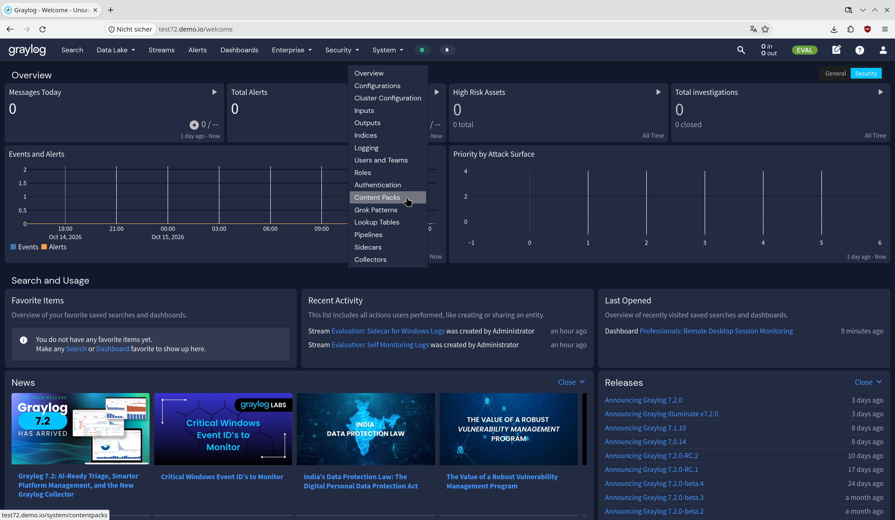
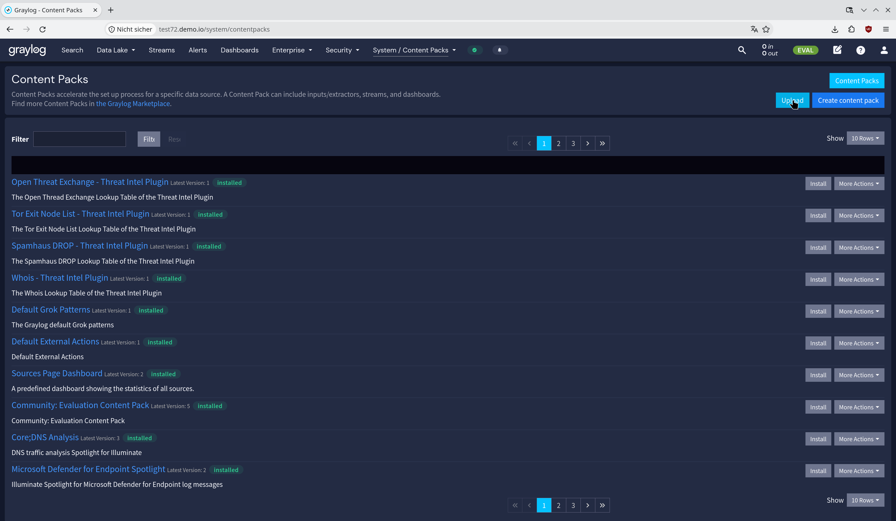
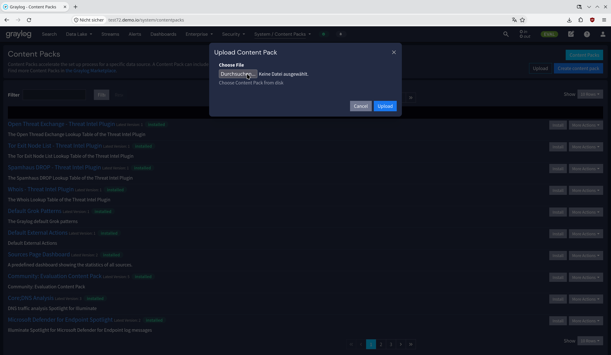
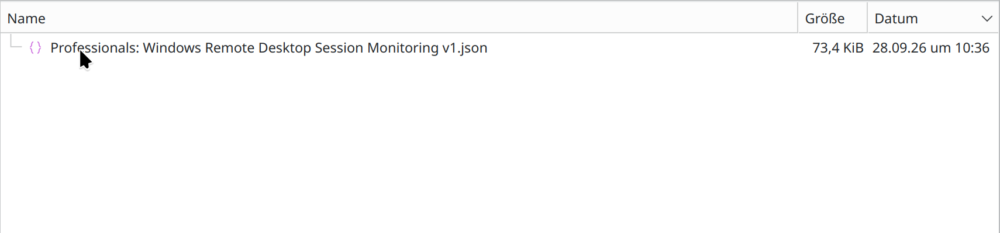
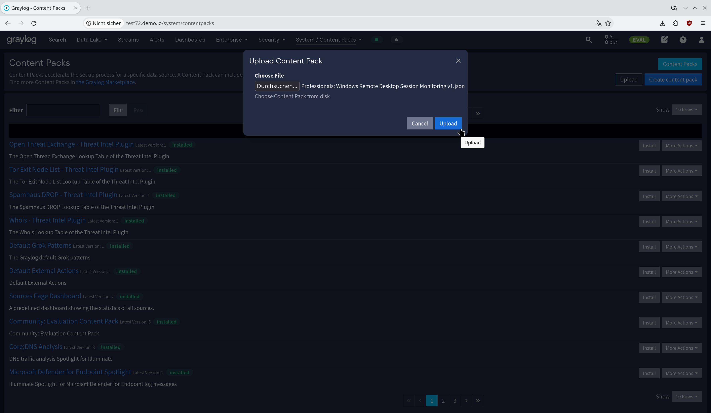
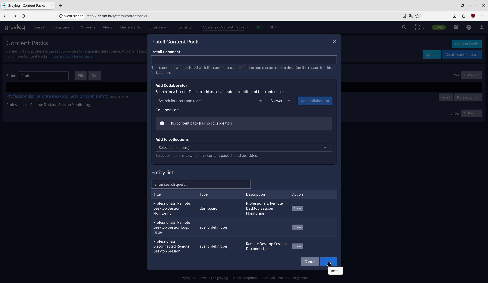
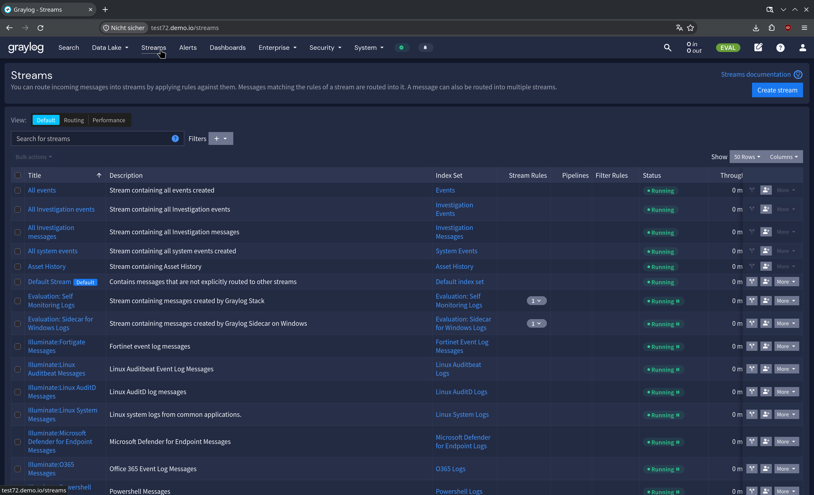
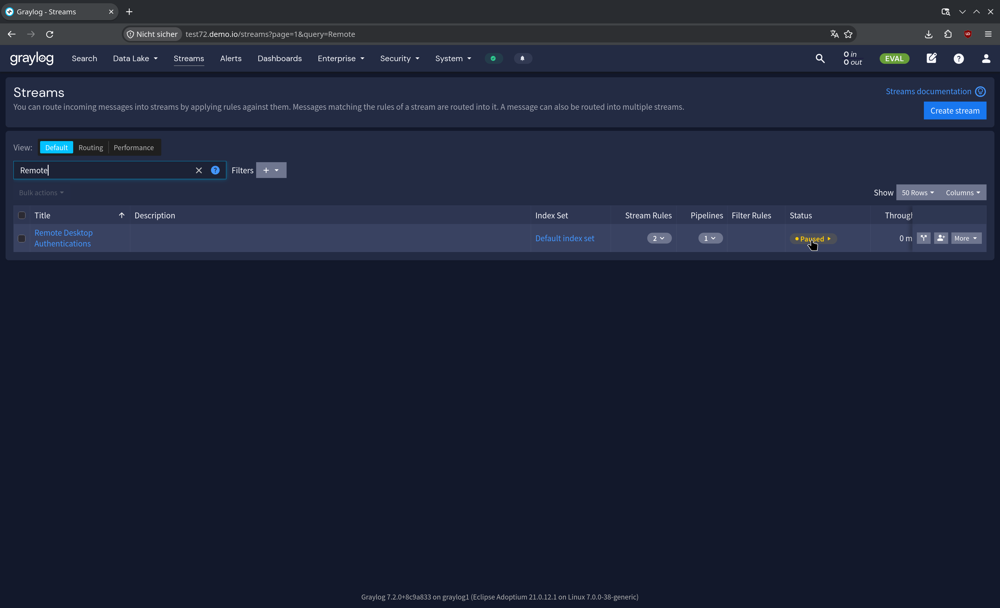
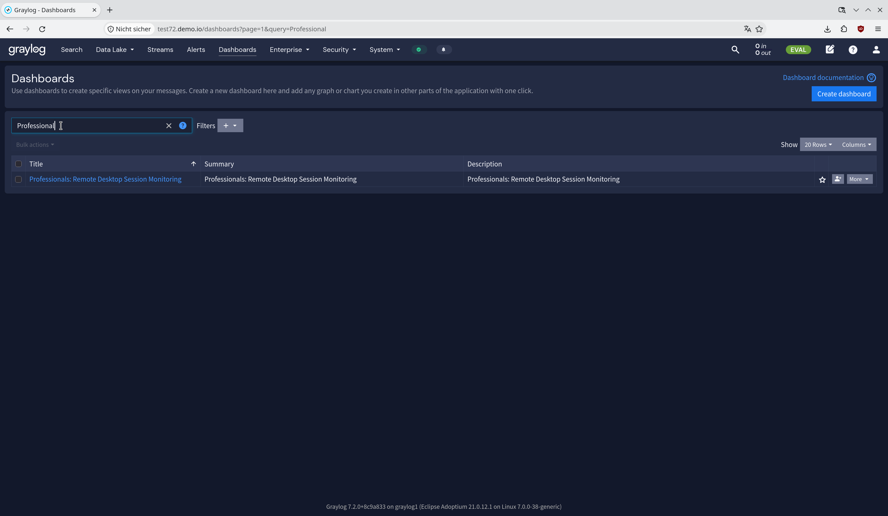
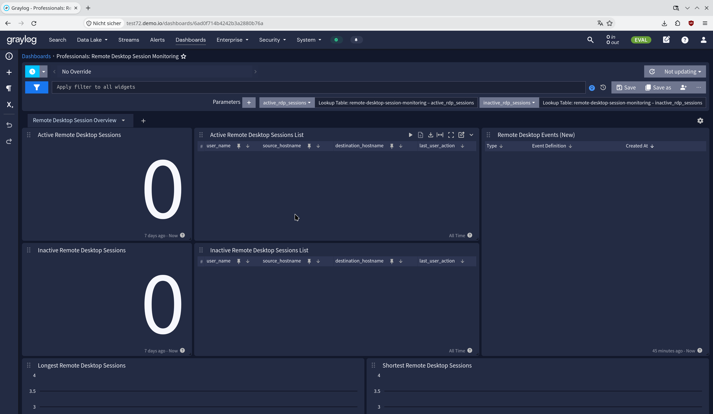

# Professionals: Remote Desktop Session Monitoring

### Download
- [View Content Pack for Download](./Content%20Pack/Professionals:%20Windows%20Remote%20Desktop%20Session%20Monitoring%20v1.json)

### Requirements
- Graylog 7.0+
- Illuminate 7.0+
- Windows Logs documenting Remote Desktop Authentications

### Getting Started
- Go to **System/Content Packs** 

- Go to **Upload** 

- **Choose File** 

- Use **Professionals: Remote Desktop Session Monitoring.json** 

- **Choose Upload** 

- Confirm with **Install** 

- Go to **Streams**

- Filter for Stream **Remote Desktop Authentications** and change its Status from **Paused** to **Running**

- Go to **Dashboards** and search for **Professional** 

- Work with the Dashboard 

